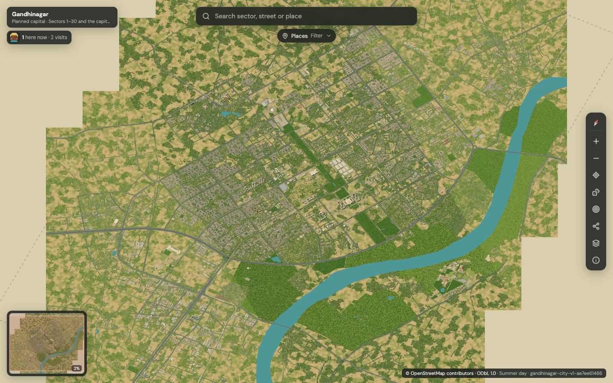
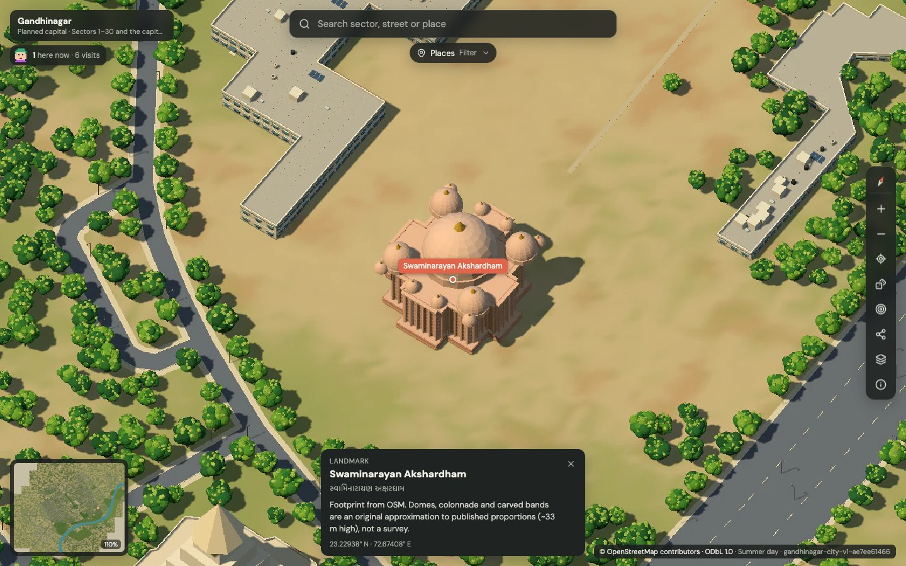
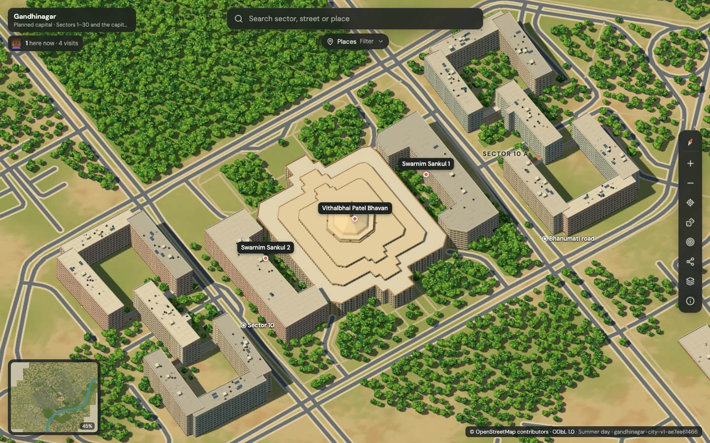
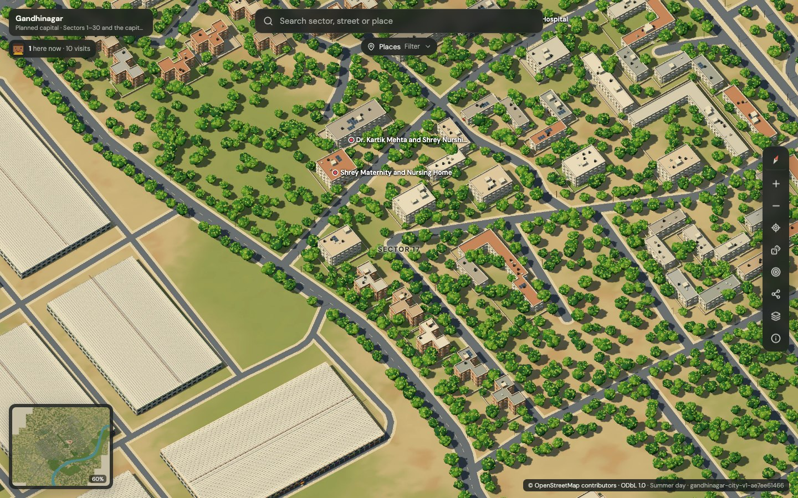
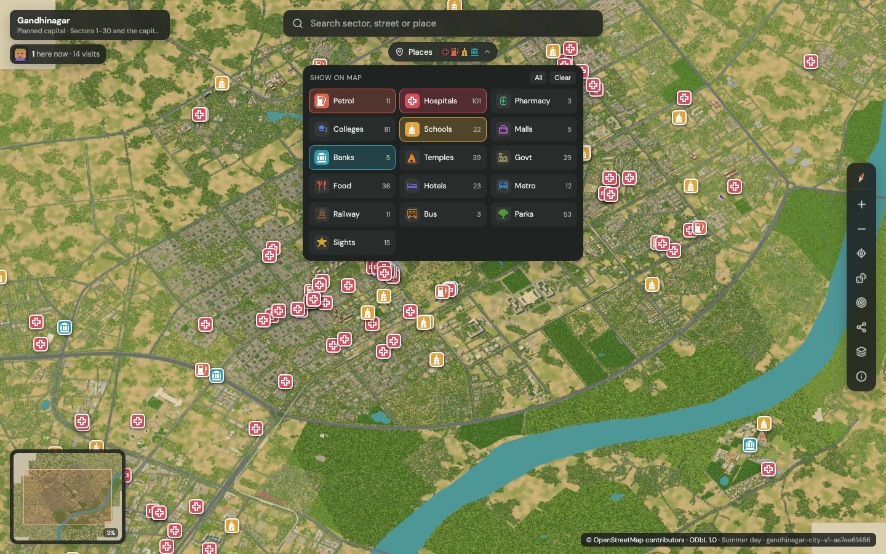
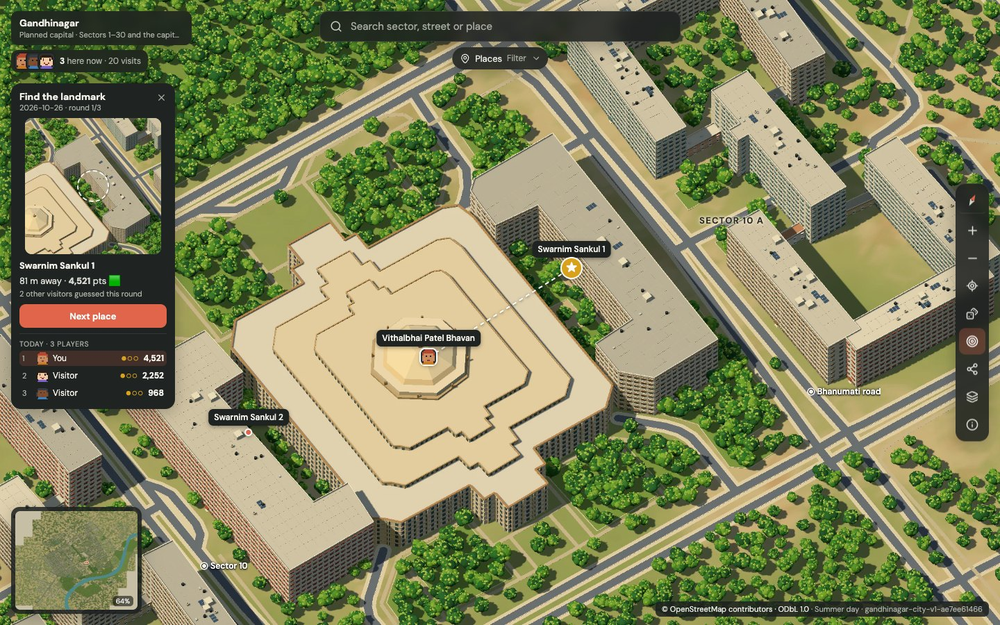
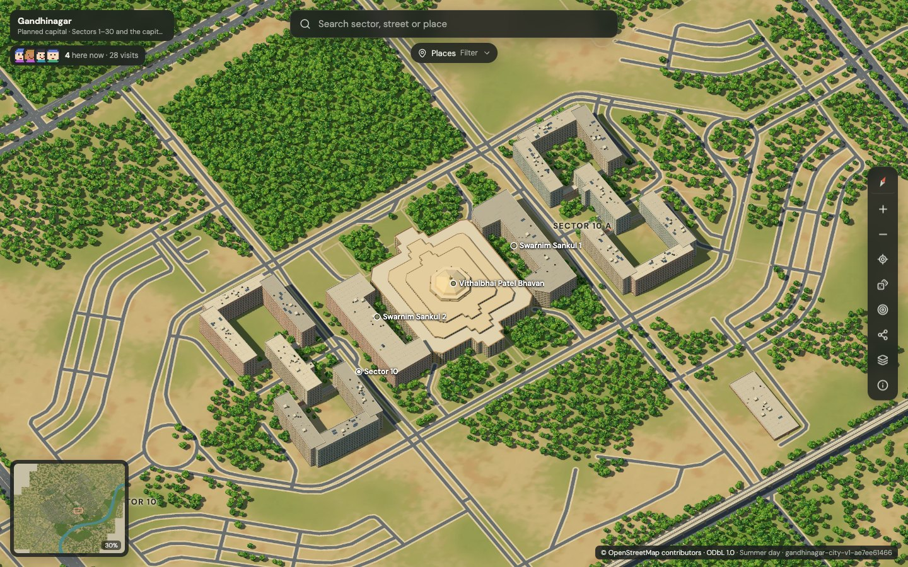
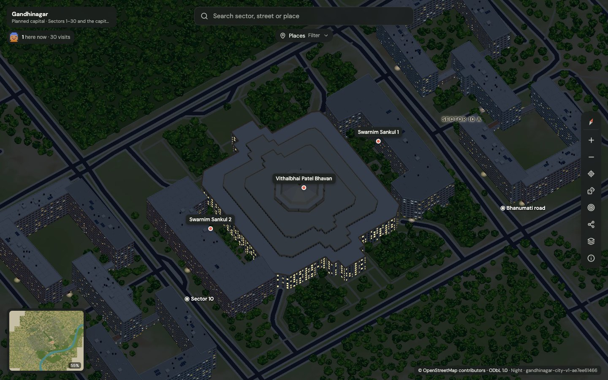
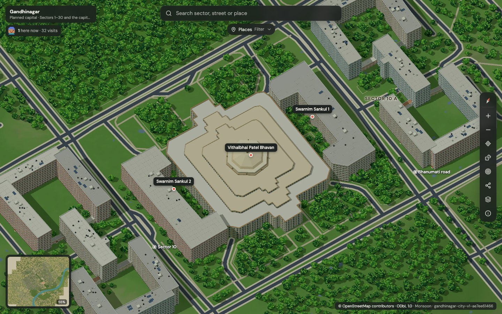
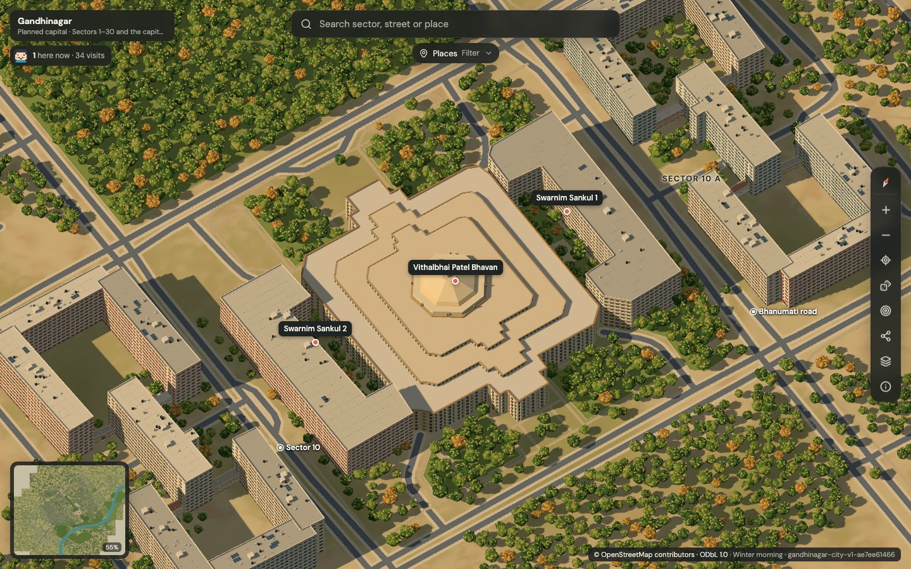

<div align="center">


# Indian Pixel City · Gandhinagar

**Illustrated, explorable maps of Indian cities, built from open data and rendered on a laptop. First city: Gandhinagar, Gujarat's capital.**

Every mapped building, road, park and lake across the 61 km² planned city is drawn at its real
position from OpenStreetMap, in a fixed bird's-eye view. Fly from the full city down to a single
temple roof, switch between summer, monsoon, winter and night, and find petrol pumps, hospitals,
schools or metro stations with pixel-icon filters. It runs locally, with no map service and no API key.

[](https://react.dev)
[](https://threejs.org)
[](https://openseadragon.github.io)
[](https://vitejs.dev)
[](https://nodejs.org)
[](https://www.openstreetmap.org/copyright)
[](#-how-it-works)

[How close is it?](#-how-close-is-it-to-the-real-gandhinagar) · [Features](#-features) · [Quick start](#-quick-start) · [Shortcuts](#-keyboard-shortcuts) · [How it works](#-how-it-works) · [Project structure](#-project-structure) · [Roadmap](#-roadmap)

<br />



</div>

<br />

## ✦ Demo

<div align="center">

<br />
<sub>24-second highlight: city overview → sectors → Akshardham → capital complex · <a href="docs/demo.mp4">full 45-second MP4</a> adds night, place filters and a minimap jump</sub>
</div>

## ✦ At a glance

<table>
  <tr>
    <td align="center"><b>61 km²</b><br /><sub>planned city, Sectors 1–30</sub></td>
    <td align="center"><b>25,969</b><br /><sub>buildings drawn</sub></td>
    <td align="center"><b>7,023</b><br /><sub>roads</sub></td>
    <td align="center"><b>2.75 Gpx</b><br /><sub>58,368 × 47,104 px at 5 px/m</sub></td>
    <td align="center"><b>4</b><br /><sub>times & climates</sub></td>
    <td align="center"><b>755</b><br /><sub>searchable places, 16 filters</sub></td>
  </tr>
</table>

<table>
  <tr>
    <td width="50%"></td>
    <td width="50%"></td>
  </tr>
  <tr>
    <td align="center"><sub><b>Akshardham</b> — modelled to its published ~108 ft height, pink sandstone</sub></td>
    <td align="center"><sub><b>Capital complex</b> — Vidhan Sabha dome, Swarnim Sankul, Sachivalaya</sub></td>
  </tr>
  <tr>
    <td width="50%"></td>
    <td width="50%"></td>
  </tr>
  <tr>
    <td align="center"><sub><b>Sector housing</b> — compound walls, roof tanks, neem-lined streets</sub></td>
    <td align="center"><sub><b>Places</b> — pixel-icon filters for petrol, hospitals, schools, metro…</sub></td>
  </tr>
  <tr>
    <td width="50%"></td>
    <td width="50%"></td>
  </tr>
  <tr>
    <td align="center"><sub><b>Daily game</b> — find today's 3 places; see where others guessed</sub></td>
    <td align="center"><sub><b>Who's here</b> — anonymous pixel faces, live count and visits</sub></td>
  </tr>
</table>

<table>
  <tr>
    <td width="33%"></td>
    <td width="33%"></td>
    <td width="33%"></td>
  </tr>
  <tr>
    <td align="center"><sub><b>Night</b> — lit windows, sodium street-lamp pools</sub></td>
    <td align="center"><sub><b>Monsoon</b> — overcast, greener, puddles</sub></td>
    <td align="center"><sub><b>Winter morning</b> — low sun, autumn tints</sub></td>
  </tr>
</table>

## ✦ How close is it to the real Gandhinagar?

Measured with [`tools/qa/fidelity.py`](tools/qa/fidelity.py) inside the OSM city polygon (way/1104668864, 61.4 km²). Results are in `outputs/city/fidelity.json`.

| What we checked | Result |
|---|---|
| OpenStreetMap above-ground buildings drawn at their real footprint | **100 %** (25,969 of 25,969; one tagged underground, `layer=-1`, skipped) |
| OpenStreetMap roads drawn (excluding tunnels) | **99.5 %** (6,989 of 7,023) |
| Map ↔ geography transform (lat/lon → pixel → ground) | **0.000 px** round-trip error |
| Region seams: pixels identical to a single continuous render | **99.3 %** (mean difference 0.018 / 255) |
| Real buildings present: VEDAS satellite footprints with a matching OSM building | **54 %** of 35,241 |
| Position agreement between the two independent footprint sets | median **6.7 m**, 90 % within 12.3 m |
| Building heights taken from real data (height / levels tags) | **17.5 %**; the rest are size-graded estimates |

**For the record:** everything OpenStreetMap maps above ground in Gandhinagar — **all 25,969 buildings, 99.5 % of roads, plus its parks and lakes** — sits in this map at its real position across **61 km²**. A second, independent satellite-derived building survey (VEDAS LoD1) finds a matching building for **about half** of its footprints. The other half are mostly small structures that nobody has mapped in OSM yet, so the map is as complete as the open data.

What is *not* a measured match: facades, windows, roof tanks, compound walls, landmark domes, ground texture and trees outside mapped parks are authored illustration. Tree density follows the Gujarat Forest Department's ~54 % tree-cover estimate, but individual tree positions are invented. VEDAS is used only for this comparison and never in the render.

## ✦ Features

**The whole city, one image**
- **Sectors 1–30, the capital complex and the riverfront** on one orthographic lattice: 58,368 × 47,104 px, 17 zoom levels, 512 px WebP tiles.
- **Region-streamed rendering**: 154 regions of 4 × 4 chunks, each with a 260 m margin for shadows and neighbours. Region boundaries stay invisible (99.3 % identical pixels).
- **Fixed bird's-eye camera** (azimuth 25°, elevation 55°), the same in every layer, so switching layers never moves the view.

**Buildings people recognise**
- **12 typologies from OSM tags**: houses, apartment blocks, government offices, schools with verandahs, hospitals, shops with shutters and signboards, sheds with corrugated roofs, glass towers, construction frames, canopies, water towers, temples (shikhara), mosques and churches.
- **Real roof shapes**: OSM `gabled` / `hipped` roofs drawn pitched; `building:colour` and `roof:colour` honoured.
- **Landmarks**: Vithalbhai Patel Bhavan (octagonal dome, stepped roof), Swaminarayan Akshardham (published proportions, pink sandstone), Dandi Kutir (41 m salt-mound shell), Mahatma Mandir (published hall height), Metro Line 2 viaduct.
- **Indian rooftops**: black water tanks, stair cabins, AC units, solar rows, placed only where they fit inside the parapet.

**Neighbourhoods that feel lived-in**
- **Compound walls, gates and yards** around residential plots (inferred, and flagged as such).
- **Dense, Gandhinagar-green planting**: neem-like crowns in mapped parks, along avenues and in yards, plus palms on wide roads. Density follows the documented ~54 % tree cover.
- **Street lamps, parking stripes, medians and the elevated metro.**

**Time & climate** (same geometry, different light)
- **Summer day**, **Monsoon** (overcast, lush, wet roads, puddles, cloud shadows), **Winter morning** (low sun, long shadows, autumn tints), **Night** (emissive windows, sodium lamp pools, lit metro deck).
- Plus **Pixel edge** (restrained 1 px normal/depth outline) and **Source geometry** layers.

**Explore**
- **Search** in English, Gujarati or by type. Typos, abbreviations (*daiict*, *iit*) and local names (*Vidhan Sabha*, *Secretariat*) work.
- **Places filter**: 16 pixel-icon categories — petrol pumps, hospitals, pharmacies, colleges, schools, malls, banks, temples, government offices, food, hotels, **metro stations, railway stations, bus stands**, parks and sights.
- **Place names appear as you zoom in**, decluttered so labels never overlap.
- **Minimap** with a live view box (click or drag to move), share links with view, layer, filters and image version, and a mobile layout.
- **Random landmark** (🎲 / `R`): a shuffle-bag tour of the curated landmarks, idea borrowed from Isometric Málaga.

**Play together**
- **Who's here now**: a stack of deterministic 12×12 pixel faces (one per open tab, generated from a random anonymous id), with a live count and total visits. No IPs, cookies or accounts are used.
- **Daily "Find the landmark"** (`D`): everyone gets the same 3 places each day (IST). The clue is a close-up crop of the real tiles. Pan the crosshair onto the spot and guess, and you are scored by ground distance. After you guess, you see other visitors' guesses as their faces, plus today's board and a copyable 🟩🟨🟧🟥 result. Without the social server the counter hides and the game plays solo. See [docs/ENGAGEMENT-IDEAS.md](docs/ENGAGEMENT-IDEAS.md) for the ranked ideas behind it.

## ✦ Quick start

> **Requires** Node.js 22.13+, Python 3.9+ and Google Chrome. FFmpeg is needed only for the demo video.

```bash
git clone https://github.com/ImliStack/Pixel-City-Gandhinagar-.git "Pixel City Gandhinagar"
cd "Pixel City Gandhinagar"
npm ci
python3 -m venv .venv && .venv/bin/python -m pip install -r requirements.lock.txt
npm run dev                 # → http://127.0.0.1:5173
```

`npm run dev` also serves the presence and daily-game API (`/api/social/beat`, in memory). Open two tabs to see two faces and play against yourself.

**Deploying (Cloudflare).** `npm run build`, upload `outputs/maps/` to R2 (or Pages assets), then `npx wrangler deploy --config deploy/cloudflare/wrangler.toml`. The Worker routes `/api/social/*` to one Durable Object, which keeps live presence in memory and stores visits and today's board in its storage. An optional KV mirror holds the visit total. The protocol and room logic are the same module the dev server uses (`apps/viewer/shared/social-core.mjs`).

The exported map in `outputs/maps/gandhinagar-city` opens straight away. To rebuild it from source:

| Script | What it does |
|---|---|
| `npm run doctor` | Hardware and dependency report |
| `npm run fetch-pilot` | Verify the cached OSM extract (16 Overpass tiles); network only with `-- --refresh` |
| `npm run audit-data` | OSM → projected, repaired features + `audit.json` |
| `npm run build-scene` | Global layout + one scene per region (`outputs/city/scenes/`) |
| `npm run render-pilot` | Render every layer (`-- --mode A` for one); resumable, hash-checked chunks |
| `npm run export-map` | Deep Zoom tiles straight from chunks + viewer metadata |
| `npm run verify` · `verify:browser` | Node + Python tests · Playwright viewer QA |
| `npm run demo` | Record the navigation demo (MP4 + README GIF) |

`config/active.json` picks the map. `?map=gandhinagar-capital` opens the earlier capital-area pilot and `?map=jaipur` the historical Jaipur map.

## ✦ Keyboard shortcuts

| Key | Action |
|---|---|
| `/` | Search |
| `+` `−` | Zoom |
| `0` · `Home` | Reset to the whole city |
| Arrow keys | Pan |
| `R` | Fly to a random landmark |
| `D` | Daily landmark game |
| `G` | Geography debug overlay |
| `?` | About this map |
| `Esc` | Close panels / clear selection |

## ✦ How it works

1. **Data.** The OSM city bbox is downloaded once, in 16 Overpass tiles, each cached with a SHA-256 hash and provenance, then merged by element id (36,335 elements). Features are projected to UTM 43N, repaired and deduplicated.
2. **Layout.** One global orthographic camera is sized to the city polygon plus 350 m, split into 1024 px chunks and 4 × 4-chunk regions.
3. **Render.** Each region scene is built in headless Chrome with Three.js and renders only its own chunks: buildings by typology, instanced trees, a world-anchored ground texture, and shadows on a per-chunk light-space texel grid that stays the same across chunks. Typical region: 4–9 s, peak memory ≤ 1.6 GiB on an Apple M3 with 8 GB.
4. **Tiles.** A chunk-native Deep Zoom builder makes each lower zoom level from 2 × 2 box-averaged cores. Its output is byte-identical to libvips's own DZI, without ever building the 2.75 Gpx image.
5. **View.** React + OpenSeadragon. Search, filters, labels and share state are all local.

Rendering details — emissive shaders, depth buffers, render passes, climate lighting — are explained in [docs/RENDERING-NOTES.md](docs/RENDERING-NOTES.md).

## ✦ Project structure

```
apps/viewer/            React + OpenSeadragon viewer (search, places filter, labels, layers, minimap)
config/cities/          city + data configs (gandhinagar-city, gandhinagar capital pilot, sample)
tools/data/             fetch_tiled.py (Overpass tiles), prepare.py (projection, repair, audit)
tools/city/             regions.py (layout + region scenes), render.mjs, pyramid.mjs, render-all.sh
tools/capital/          scene.mjs (the renderer), export.mjs, categories.mjs
tools/qa/               fidelity.py, viewer.mjs, demo.mjs, readme-shots.mjs, diagnostics
tests/                  city, capital pilot, sample and data tests
outputs/maps/           exported Deep Zoom maps (city, capital pilot, Jaipur history)
docs/                   rendering notes, pilot write-up, data & provenance
```

## ✦ FAQ

<details>
<summary><b>Why not Google Maps or satellite imagery?</b></summary>
<br />
Their terms don't allow copying map data, imagery or 3D buildings into your own renders, and the map is meant to run without any online service. OpenStreetMap's ODbL licence allows exactly this use, with attribution.
</details>

<details>
<summary><b>Is this AI-generated art?</b></summary>
<br />
No. Every layer is a deterministic WebGL render of the same geometry. No image model was run: the original Qwen image-edit checkpoint needs far more memory than this 8 GB machine has. The illustrated look comes from geometry, materials and lighting.
</details>

<details>
<summary><b>Why is my building missing?</b></summary>
<br />
If it isn't in OpenStreetMap it isn't drawn — Indian Pixel City never invents buildings. An independent survey suggests about half of Gandhinagar's structures are mapped. Adding yours to <a href="https://www.openstreetmap.org">openstreetmap.org</a> brings it in on the next rebuild.
</details>

<details>
<summary><b>Can I search for the airport or PDEU?</b></summary>
<br />
Ahmedabad's SVPI airport lies outside this coverage, and PDEU is not in the downloaded OSM extract, so neither can be found. The Airport filter appears automatically on maps that include one.
</details>

## ✦ Status against the original brief

| Brief item | Status |
|---|---|
| Verified geographic pipeline (OSM fetch, UTM projection, repair, audit) | ✅ done — 16 hashed Overpass tiles, 36,335 elements |
| One global orthographic lattice, resumable padded chunks with config/scene/code hashes | ✅ done — real interrupt → resume gave bit-identical chunks |
| Bounded memory, measured timing and RSS | ✅ done — ≤ 1.63 GiB peak, 12–21 min per city layer |
| A stylised render, B restrained pixel/edge treatment | ✅ done, plus night / monsoon / winter |
| C local image-model stage | ❌ not done — no licensed model fits 8 GB on this machine; documented, not faked |
| Adjacent-region continuity vs a larger direct render | ✅ done — 99.3 % identical pixels at region corners |
| DZI / WebP 512 px, overlap 1, chunk-native | ✅ done — byte-identical to libvips at every level |
| Viewer: full-window art, compact search, vertical controls, lower-left minimap, share/version state, local fonts, zero external requests | ✅ done — browser QA 29/29 |
| Search, place filters (incl. metro, rail, bus), zoom labels | ✅ done |
| 30–40 s navigation demo | ✅ done (45 s MP4 + 24 s GIF) |
| Reference-video art quality | ⚠️ not met — deterministic illustration, see the fidelity table above |
| OSM2World comparison | ⚠️ investigated earlier, timed out; the Three.js renderer is used instead |
| Visitor presence + daily multiplayer game | ✅ done locally — Cloudflare Worker + Durable Object written and unit-tested, not deployed yet |
| Public hosting (Cloudflare R2 + Pages) | ⏳ planned — needs your Cloudflare account; tiles ≈ 3.5 GB |

## ✦ Roadmap

- [x] Capital-area pilot → full planned city (Sectors 1–30)
- [x] Typology buildings, landmark models, plot walls, street lamps, metro viaduct
- [x] Summer, monsoon, winter and night layers
- [x] Pixel-icon place filters, transport filters, close-zoom labels, typo-tolerant search
- [x] Visitor presence faces and the daily Find-the-landmark game
- [ ] Live cursors of other visitors, scavenger hunts (see docs/ENGAGEMENT-IDEAS.md)
- [ ] GIFT City and the riverfront south of the current extent
- [ ] Terrain (open DEM) instead of flat ground
- [ ] Hand-modelled Mahatma Mandir, Sachivalaya blocks and Infocity
- [ ] A local image-model polish pass, if a licensed model fits in 8 GB

## ✦ Data & credits

- **Map data** © [OpenStreetMap contributors](https://www.openstreetmap.org/copyright), ODbL 1.0. Downloaded via Overpass API; per-tile hashes in `data/raw/gandhinagar-city.overpass.provenance.json`.
- **Comparison only:** VEDAS LoD1 Gandhinagar building footprints (research; not rendered).
- **Facts used for authored models:** Wikipedia (Gujarat Legislative Assembly, Swaminarayan Akshardham), Gujarat Tourism, WorldArchitecture (Dandi Kutir), Gujarat Forest Department tree-cover study.
- Visual reference: the tinygyn.com illustrated map of Goiânia — style only. No code, imagery or geography was copied.
- Built with React, Three.js, OpenSeadragon, Sharp/libvips, Shapely, pyproj and Playwright.
